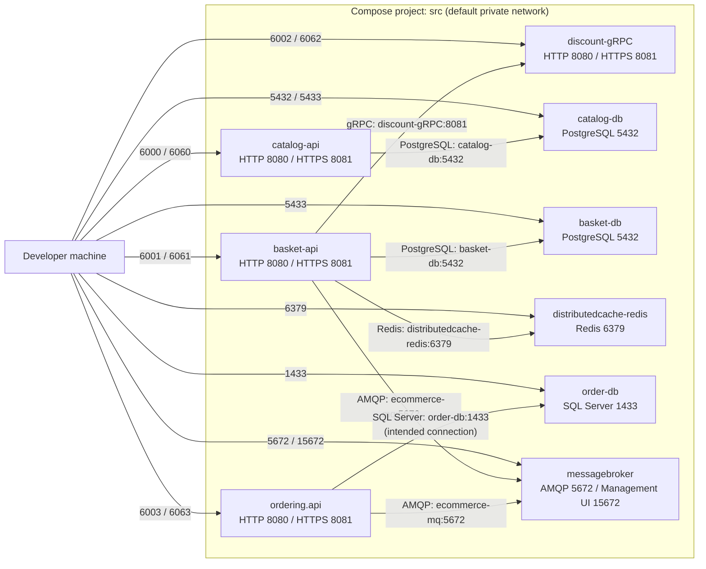

# E-commerce Docker Compose guide

This memo explains [`compose.yaml`](compose.yaml), how its containers communicate, how the .NET Dockerfiles build the APIs, and how to run and troubleshoot the local stack. It describes the configuration currently in the repository; the **Important checks in the current file** section calls out settings that need attention before relying on it.

## 1. What Docker Compose does here

Docker Compose reads `compose.yaml` and creates a local application stack from its **services**. A service describes a container (or a set of containers), including its image or build instructions, environment, ports, storage, dependencies and restart policy.

The top-level `services:` contains the containers. Compose also creates a private default network for this project, unless configured otherwise. Containers on that network can reach one another using their **service names** and the ports on which the processes listen inside the containers. Host port mappings are for connections entering from the developer's computer; containers normally do not use those host ports to reach each other.

The top-level `volumes:` declares named persistent storage. The project name is `src` in the command used for this stack (`-p src`), so Compose normally gives the network and named volumes names such as `src_default` and `src_postgres_catalog`.

## 2. Service relationship diagram



Solid arrows show intended application connections derived from the Compose settings. Host-to-container arrows are published ports. `depends_on` adds startup ordering for selected services; it is not an application connection and does not guarantee that a database or broker is ready to accept requests.

## 3. Service-by-service overview

| Compose service | Purpose | Its consumers / data |
|---|---|---|
| `catalog-db` | PostgreSQL database initialized as `CatalogDb` | `catalog-api` |
| `basket-db` | Separate PostgreSQL database initialized as `BasketDb` | `basket-api` |
| `distributedcache-redis` | Redis cache | `basket-api` |
| `order-db` | SQL Server Developer Edition | Intended for `ordering.api` |
| `messagebroker` | RabbitMQ broker with management UI | `basket-api` and `ordering.api` |
| `catalog-api` | Catalog .NET API | Connects to `catalog-db` |
| `basket-api` | Basket .NET API | Connects to `basket-db`, Redis, Discount gRPC and RabbitMQ |
| `discount-gRPC` | Discount .NET gRPC service using SQLite | Called by `basket-api`; SQLite is local to this container as currently configured |
| `ordering.api` | Ordering .NET API | Intended to connect to SQL Server and RabbitMQ |

### Infrastructure services

**`catalog-db` and `basket-db`**

- `image: postgres:18` uses the PostgreSQL 18 image from the image registry; Compose does not build these images from this repository.
- `POSTGRES_USER`, `POSTGRES_PASSWORD` and `POSTGRES_DB` are initialization variables understood by the official PostgreSQL image. They create the initial database and user when the data directory is first initialized. Changing these values later does not necessarily change an already-initialized database.
- Both containers listen on port `5432`. `catalog-db` publishes host port `5432`; `basket-db` publishes host port `5433`, avoiding a collision on the developer machine.
- `postgres_catalog` and `postgres_basket` retain PostgreSQL data across container replacement. They are independent volumes, so the two databases do not share data.

**`distributedcache-redis`**

- `image: redis` downloads the Redis image (no explicit tag is set, so this follows the image's default tag).
- The API uses the service name and internal port: `distributedcache-redis:6379`.
- Host port `6379` is published for tools running on the developer machine. No named data volume is declared, so this configuration should be treated as a development cache, not durable storage.

**`order-db`**

- `image: mcr.microsoft.com/mssql/server:2022-latest` selects SQL Server 2022.
- `platform: linux/amd64` requests an x86-64 Linux image. On an Apple Silicon Mac this can require emulation (such as Rosetta) and may be slower than a native image.
- `ACCEPT_EULA=Y` accepts Microsoft's license for local startup; `MSSQL_PID=Developer` selects the Developer edition.
- `MSSQL_SA_PASSWORD` configures the `sa` account. SQL Server enforces password complexity; use a strong local secret and do not commit real credentials.
- `orderdb_data` stores SQL Server files under `/var/opt/mssql`, preserving them when the container is recreated.
- SQL Server listens on `1433` inside the Compose network and is also published on host port `1433`.

**`messagebroker`**

- The service's Compose name is `messagebroker`; `container_name: rabbitmq-messagebroker` is a separate, fixed Docker container name.
- `rabbitmq:management` includes RabbitMQ plus its web management plugin.
- `hostname: ecommerce-mq` sets the container hostname. The API connection strings currently use `ecommerce-mq`; the Compose service name `messagebroker` is the most direct in-network name to use and is automatically provided by Compose DNS.
- `RABBITMQ_DEFAULT_USER` and `RABBITMQ_DEFAULT_PASS` set the initial broker login for a new broker data directory. No RabbitMQ data volume is declared, so broker state is not explicitly persisted by this Compose file.
- Port `5672` is AMQP for applications; `15672` is the management web interface. From the host, use `localhost:15672`; from a container, use the broker's in-network name and port `5672`.

### Application services

All four APIs are built from source using `build`, rather than pulled from the commented-out `image` examples. Each runs in a .NET 10 ASP.NET runtime image, uses `/app` as its working directory, and exposes container ports `8080` (HTTP) and `8081` (HTTPS).

**`catalog-api`**

- `ASPNETCORE_ENVIRONMENT: Development` selects the Development configuration.
- `ASPNETCORE_HTTP_PORTS` and `ASPNETCORE_HTTPS_PORTS` tell ASP.NET Core which ports to listen on inside the container.
- `ASPNETCORE_Kestrel__Certificates__Default__Path` and `...__Password` configure Kestrel's HTTPS certificate. The path is inside the container and is backed by the host certificate-directory mount described below.
- `ConnectionStrings__Database` overrides the application's `ConnectionStrings:Database` setting. It uses PostgreSQL host `catalog-db`, port `5432`, and database `CatalogDb`. The `******` shown in the current Compose file is a literal placeholder if it is actually present in the file; replace it with the intended password (or use a secret mechanism) before expecting authentication to work.
- The commented Redis setting is inactive; `catalog-api` currently has no Redis dependency in Compose.

**`basket-api`**

- It uses the same ASP.NET environment, listening-port and certificate settings as `catalog-api`.
- `ConnectionStrings__Database` selects PostgreSQL service `basket-db`, its internal port `5432`, and database `BasketDb`.
- `ConnectionStrings__Redis: distributedcache-redis:6379` selects Redis by Compose service name and internal port.
- `GrpcSettings__DiscountUrl: https://discount-gRPC:8081` directs the gRPC client to the Discount service's HTTPS listener inside the network. Its URL uses the service name, not the host-published port `6062`.
- `MessageBroker__Host`, `MessageBroker__UserName` and `MessageBroker__Password` configure the AMQP connection. The current host value is `amqp://ecommerce-mq:5672`; Compose DNS service-name addressing would conventionally use `amqp://messagebroker:5672`.
- `depends_on` lists the database, Redis, Discount API and broker as startup dependencies. It does not wait for their health/readiness.

**`discount-gRPC`**

- The ASP.NET variables configure Development and the same internal HTTP/HTTPS ports and certificate file as the other APIs.
- `ConnectionStrings__Database: Data Source=discountDb` overrides SQLite's connection string from `appsettings.json` (`discountDb.db`). The configured file resides in the container's writable filesystem; no volume mounts it, so the SQLite database is not guaranteed to survive container recreation.
- It publishes host ports `6002` and `6062`; other containers should connect to `discount-gRPC:8080` (HTTP) or `discount-gRPC:8081` (HTTPS).
- There is no `depends_on` entry because this service has no Compose-managed dependency listed.

**`ordering.api`**

- It uses the same ASP.NET Development and internal port settings. Its HTTPS endpoint uses the mounted `ecommerce-dev.pfx` certificate at `/home/app/.aspnet/https/ecommerce-dev.pfx`; ensure that certificate exists on the host at `${HOME}/.aspnet/https/ecommerce-dev.pfx`.
- `MessageBroker__Host`, `MessageBroker__UserName` and `MessageBroker__Password` configure RabbitMQ; `FeatureManagement__OrderFulfillment: false` overrides the `FeatureManagement:OrderFulfillment` setting and disables that feature for this Compose launch.
- It depends on `order-db` and `messagebroker`.
- The SQL Server connection setting uses the Compose service name `order-db` so the API can resolve the database container over the Compose network.

## 4. Environment-variable naming and configuration

Compose passes `environment` entries into a container as environment variables. In .NET configuration, double underscores (`__`) represent nested configuration separators. For example:

```yaml
ConnectionStrings__Database: "Host=basket-db;Port=5432;Database=BasketDb;Username=postgres;Password=..."
```

becomes the .NET configuration key `ConnectionStrings:Database`, which `GetConnectionString("Database")` reads. Similarly, `GrpcSettings__DiscountUrl` becomes `GrpcSettings:DiscountUrl`, and `FeatureManagement__OrderFulfillment` becomes `FeatureManagement:OrderFulfillment`. Environment variables override the corresponding values from `appsettings.json`.

The YAML mapping form is `VARIABLE_NAME: value`. A list form is also valid, such as `- VARIABLE_NAME=value`. Avoid putting `=` inside a mapping key when the goal is to set an environment variable; Compose can parse that as a different key rather than the intended variable.

## 5. Network names, ports and connection strings

Compose creates a private network for this project. A container-to-container connection uses:

```text
<compose-service-name>:<container-listening-port>
```

For example, basket PostgreSQL is `basket-db:5432`, not `localhost:5433`. `localhost` inside `basket-api` refers to the basket API container itself. The host mapping `5433:5432` is for a database client running on the developer machine.

Port mappings use the format `"HOST_PORT:CONTAINER_PORT"`:

| Service | Host port(s) | Container port(s) | Typical host access |
|---|---:|---:|---|
| `catalog-api` | `6000`, `6060` | `8080`, `8081` | HTTP `localhost:6000`, HTTPS `localhost:6060` |
| `basket-api` | `6001`, `6061` | `8080`, `8081` | HTTP `localhost:6001`, HTTPS `localhost:6061` |
| `discount-gRPC` | `6002`, `6062` | `8080`, `8081` | HTTP `localhost:6002`, HTTPS `localhost:6062` |
| `ordering.api` | `6003`, `6063` | `8080`, `8081` | HTTP `localhost:6003`, HTTPS `localhost:6063` |
| `catalog-db` | `5432` | `5432` | `localhost:5432` |
| `basket-db` | `5433` | `5432` | `localhost:5433` |
| `distributedcache-redis` | `6379` | `6379` | `localhost:6379` |
| `order-db` | `1433` | `1433` | `localhost:1433` |
| `messagebroker` | `5672`, `15672` | `5672`, `15672` | AMQP `localhost:5672`; UI `localhost:15672` |

Publishing ports makes them reachable from the host; it does not change the port used by another service on the Compose network. If a host port is already taken, change the left side of the mapping while keeping the right side unchanged.

## 6. Volumes and bind mounts

- **Named volumes** (`postgres_catalog`, `postgres_basket`, `orderdb_data`) are managed by Docker and keep database files outside the container's writable layer. `docker compose down` normally preserves named volumes; `docker compose down -v` removes them and deletes their stored data.
- **Bind mounts** connect a host path to a container path. The API mounts `${HOME}/.microsoft/usersecrets` (or the Ordering service's `${APPDATA:-~/.microsoft}`-based path) to `/home/app/.microsoft/usersecrets`, and `${HOME}/.aspnet/https` to `/home/app/.aspnet/https`. The `:ro` suffix makes these mounts read-only inside the container.
- `${HOME}` and `${APPDATA:-...}` are expanded on the machine running Compose. Confirm these host directories exist and contain the expected development secrets/certificate. The configured certificate file must exist as `/home/app/.aspnet/https/ecommerce-dev.pfx` inside each API container.
- The named volumes protect only the paths explicitly mounted. The Discount SQLite file currently has no named volume.

## 7. How the Dockerfiles build the APIs

Each `build` block supplies:

- `context: .`: the build context is `E-commerce/src`, the directory from which this Compose file is run. Files referenced by Dockerfile `COPY` instructions must be inside this context.
- `dockerfile: ...`: the Dockerfile path relative to that context. For example, Catalog uses `Services/Catalog/CatalogAPI/Dockerfile`.

The four Dockerfiles use a **multi-stage build**:

1. `base` starts from `mcr.microsoft.com/dotnet/aspnet:10.0`, the smaller runtime image, sets `/app`, selects the image's non-root `$APP_UID` user, and documents ports `8080` and `8081` with `EXPOSE`.
2. `build` starts from `mcr.microsoft.com/dotnet/sdk:10.0`, copies project files, restores NuGet packages, copies the source and compiles the API. The Basket and Ordering Dockerfiles also copy their referenced project files before restore.
3. `publish` runs `dotnet publish` to produce deployable output under `/app/publish`.
4. `final` starts again from the runtime-only `base`, copies the published output from the earlier stage, and starts the API with `dotnet <Assembly>.dll`.

Only the final stage is used as the running image, so the SDK and build intermediates do not need to be shipped in the runtime container. `.dockerignore` excludes items such as `.git`, `.idea`, `bin`, `obj`, Dockerfiles and `.env` from the build context. `EXPOSE` documents the container's listening ports but does not publish them; the Compose `ports` entries do that.

## 8. Running and inspecting the stack

Run these commands from `E-commerce/src` (or keep the absolute compose-file path):

```bash
# Validate/normalize the Compose model without starting containers
docker compose -f compose.yaml -p src config

# Build API images and start the services in the background
docker compose -f compose.yaml -p src up -d --build

# See running services and status
docker compose -f compose.yaml -p src ps

# Follow logs for one service
docker compose -f compose.yaml -p src logs -f basket-api

# Stop and remove containers/network, but retain named-volume data
docker compose -f compose.yaml -p src down
```

`docker compose config --quiet` is a useful YAML/Compose-model check. It cannot validate that a connection string authenticates, a host name resolves at runtime, a service is healthy, or an environment variable has the key the .NET application expects. `depends_on` controls start order only unless health checks and a readiness condition are configured. Applications should retry transient dependency failures, or health checks/readiness handling should be added when required.

The `-p src` option sets the Compose project name. Use the same name with `up`, `ps`, `logs` and `down` so commands refer to the same stack and its volumes.

## 9. Important checks in the current file

1. **Ordering database variable:** The `ordering.api` service sets `ConnectionStrings__Database` to the SQL Server connection string. Use the Compose service name `order-db` for container-to-container access; `localhost` refers to the API container itself:

   ```yaml
   ConnectionStrings__Database: "Server=order-db;Database=OrderDb;User Id=sa;Password=<local-secret>;Encrypt=False;TrustServerCertificate=True"
   ```

   Use `order-db`, the Compose service name, for container-to-container access (rather than `orderdb` or `localhost`). In Compose YAML, escape a literal `$` in the password as `$$` so interpolation preserves it for the container.

2. **Password placeholders and credentials:** The PostgreSQL connection strings in this file visibly contain `******`. If these are literal file contents, substitute the correct password before expecting successful database login. The Compose file also contains simple development credentials for PostgreSQL/RabbitMQ and an SQL Server password. These are not suitable for shared, exposed or production environments; move real credentials to an appropriate secret mechanism and avoid committing them.

3. **RabbitMQ addressing:** The broker service key is `messagebroker`, while its configured hostname is `ecommerce-mq`. Compose service-name DNS is the stable conventional address; if the configured hostname is not resolvable in the running project, change the two API broker URLs to `amqp://messagebroker:5672`.

4. **Startup is not readiness:** `depends_on` alone does not ensure PostgreSQL, SQL Server or RabbitMQ has completed initialization. A service can start after its dependency container starts but before the dependency accepts connections.

5. **Development HTTPS and secrets:** The PFX password is directly configured in Compose. Keep this setup local-only, do not reuse the development certificate or password in production, and ensure the mounted certificate path matches the file on the host.

6. **Persistence scope:** The PostgreSQL and SQL Server data directories have named volumes. Redis and the Discount SQLite database do not have declared persistent volumes in this file.
